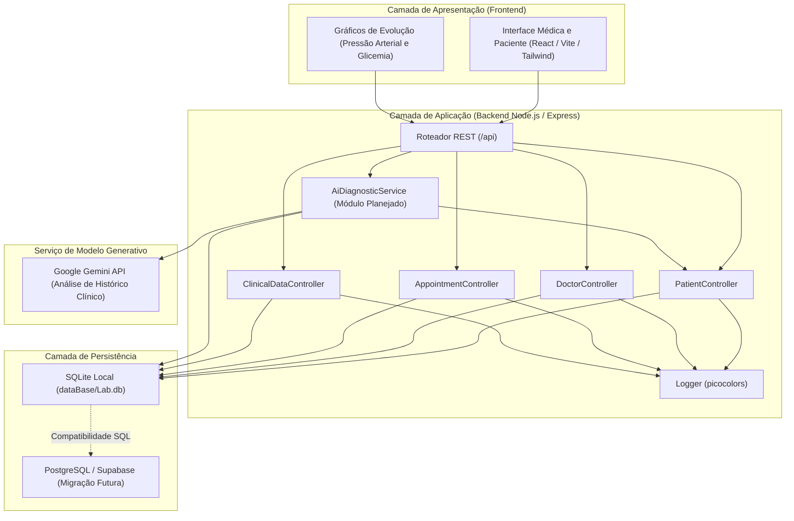
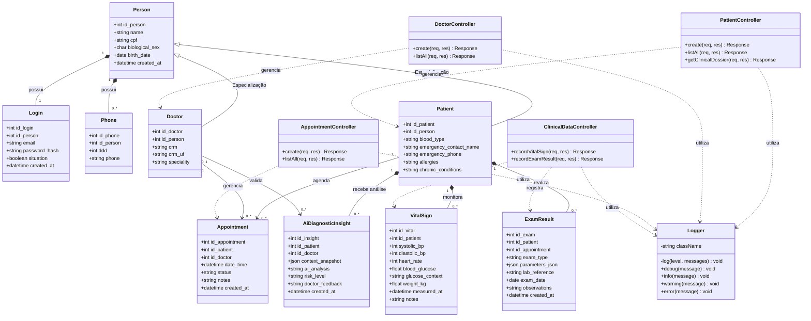
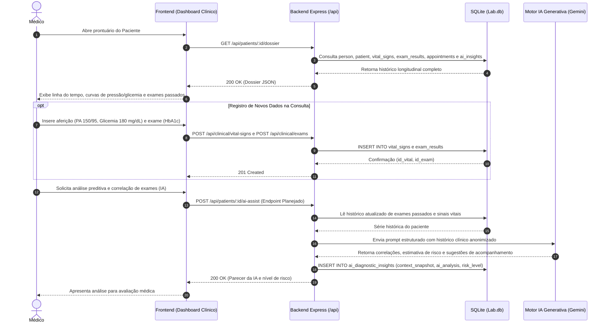
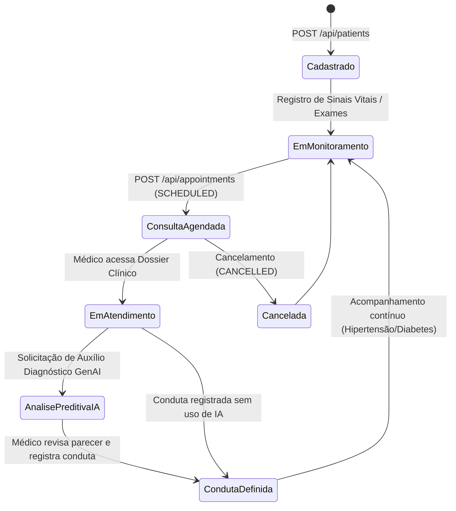

# Arquitetura do Sistema e Diagramas UML: SolveTechAi (Concent)

Este documento descreve a organização de pastas, os componentes de software e os diagramas UML do projeto SolveTechAi. A plataforma armazena dados clínicos longitudinais de pacientes com hipertensão arterial e diabetes mellitus para consulta médica e processamento futuro por modelos generativos.

## 1. Estrutura de Diretórios do Projeto

```text
SolveTechAi---Concent/
├── ai-agents-core/                  # Orquestração de agentes via Grafo Acíclico Direcionado (DAG)
│   ├── skills/
│   │   └── squad-builder/           # Ferramenta CLI para seleção e instalação de perfis de agentes
│   │       ├── scripts/squad.py     # Script de listagem, instalação (.squad/) e geração de workflow
│   │       └── SKILL.md             # Regras de operação do Squad Builder
│   ├── action.yml                   # Definição da GitHub Composite Action
│   ├── AI_INSTRUCTIONS.md           # Guia de configuração para assistentes
│   ├── main.py                      # Pipeline DAG (Notion -> Planner -> Dev -> Security -> Tester -> PR)
│   ├── requirements.txt             # Dependências Python do orquestrador
│   └── README.md                    # Instruções do módulo ai-agents-core
├── assets/                          # Arquivos estáticos (CSS e imagens)
├── backend/                         # Variáveis de ambiente de servidor
├── dataBase/                        # Arquivo local do banco SQLite (Lab.db, ignorado pelo Git)
├── docs/                            # Documentação técnica e modelagem
│   ├── DataBase_Model/
│   │   └── Conceitual_1.brM3        # Modelo conceitual original criado no brModelo
│   ├── ARCHITECTURE_UML.md          # Arquitetura e diagramas UML
│   └── WORKFLOW_GITHUB_AND_AGENTS.md# Fluxo de Git, Pull Requests e ativação de agentes
├── frontend/                        # Diretório reservado para a aplicação React + Vite + TailwindCSS
├── src/                             # Código-fonte da API Backend (Node.js + Express)
│   ├── config/
│   │   └── database.js              # Conexão SQLite e criação das 9 tabelas do sistema
│   ├── controllers/
│   │   ├── patientController.js     # Cadastro de pacientes e leitura do prontuário consolidado
│   │   ├── doctorController.js      # Cadastro e listagem de médicos
│   │   ├── appointmentController.js # Agendamento e listagem de consultas
│   │   └── clinicalDataController.js# Registro de sinais vitais e resultados de exames
│   ├── core/
│   │   └── logger.js                # Registro de logs no terminal com níveis de severidade
│   ├── routes/
│   │   └── index.js                 # Definição das rotas REST sob /api
│   ├── app.js                       # Configuração do aplicativo Express e middlewares
│   └── server.js                    # Inicialização do servidor HTTP
├── template/
│   └── index.html                   # Estrutura HTML inicial
├── .env                             # Variáveis de ambiente locais
├── .gitignore                       # Arquivos e pastas ignorados no controle de versão
└── package.json                     # Manifesto Node.js e scripts de execução
```

## 2. Diagrama de Componentes e Arquitetura Geral

O diagrama a seguir mostra a divisão entre interface, API Express, banco de dados e integração com o modelo generativo para apoio ao diagnóstico:



## 3. Diagrama de Classes UML (Domínio e Controladores)

O diagrama de classes representa as entidades persistidas no banco (incluindo a especialização de `Person` em `Patient` e `Doctor`) e os controladores responsáveis pelas regras de negócio:



## 4. Diagrama Entidade-Relacionamento (DER Físico)

Estrutura das 9 tabelas definidas em [`src/config/database.js`](file:///c:/Users/jvnno/Documents/GitHub/SolveTechAi---Concent/src/config/database.js):

```mermaid
erDiagram
    person ||--o| login : "1:1"
    person ||--o{ phone : "1:N"
    person ||--o| patient : "Herança/1:1"
    person ||--o| doctor : "Herança/1:1"
    patient ||--o{ appointment : "0:N"
    doctor ||--o{ appointment : "0:N"
    patient ||--o{ vital_signs : "0:N"
    patient ||--o{ exam_results : "0:N"
    appointment |o--o{ exam_results : "0:N"
    patient ||--o{ ai_diagnostic_insights : "0:N"
    doctor |o--o{ ai_diagnostic_insights : "0:N"

    person {
        INTEGER id_person PK
        VARCHAR name
        VARCHAR cpf UK
        VARCHAR biological_sex
        DATE birth_date
        DATETIME created_at
    }

    login {
        INTEGER id_login PK
        INTEGER id_person FK_UK
        VARCHAR email UK
        VARCHAR password_hash
        BOOLEAN situation
        DATETIME created_at
    }

    phone {
        INTEGER id_phone PK
        INTEGER id_person FK
        INTEGER ddd
        VARCHAR phone
    }

    patient {
        INTEGER id_patient PK
        INTEGER id_person FK_UK
        VARCHAR blood_type
        VARCHAR emergency_contact_name
        VARCHAR emergency_phone
        TEXT allergies
        TEXT chronic_conditions
    }

    doctor {
        INTEGER id_doctor PK
        INTEGER id_person FK_UK
        VARCHAR crm UK
        VARCHAR crm_uf
        VARCHAR speciality
    }

    appointment {
        INTEGER id_appointment PK
        INTEGER id_patient FK
        INTEGER id_doctor FK
        DATETIME date_time
        VARCHAR status
        VARCHAR notes
        DATETIME created_at
    }

    vital_signs {
        INTEGER id_vital PK
        INTEGER id_patient FK
        INTEGER systolic_bp
        INTEGER diastolic_bp
        INTEGER heart_rate
        REAL blood_glucose
        VARCHAR glucose_context
        REAL weight_kg
        DATETIME measured_at
        TEXT notes
    }

    exam_results {
        INTEGER id_exam PK
        INTEGER id_patient FK
        INTEGER id_appointment FK
        VARCHAR exam_type
        TEXT parameters_json
        VARCHAR lab_reference
        DATE exam_date
        TEXT observations
        DATETIME created_at
    }

    ai_diagnostic_insights {
        INTEGER id_insight PK
        INTEGER id_patient FK
        INTEGER id_doctor FK
        TEXT context_snapshot
        TEXT ai_analysis
        VARCHAR risk_level
        TEXT doctor_feedback
        DATETIME created_at
    }
```

## 5. Diagrama de Sequência UML: Atendimento Médico e Auxílio Diagnóstico por IA

O fluxo abaixo mostra a leitura do prontuário consolidado (`dossier`), a inserção de novos exames e aferições, e o acionamento planejado do módulo de IA para identificar tendências no histórico do paciente:



## 6. Diagrama de Estados UML: Ciclo de Monitoramento e Consulta


