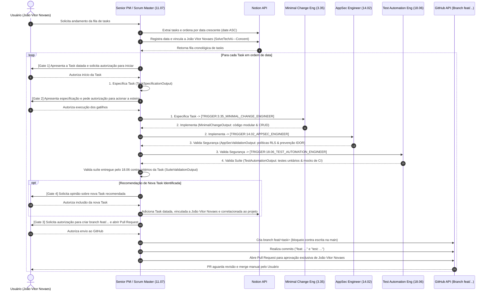
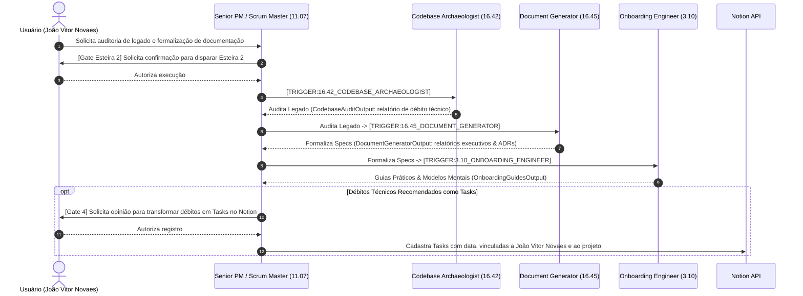
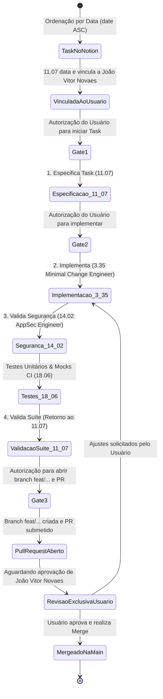

# Fluxo de Desenvolvimento no GitHub e Governanca do Scrum Master (11.07): SolveTechAi

Este documento especifica as quatro regras de negocio, o fluxo de branches e Pull Requests no GitHub e a arquitetura das duas esteiras de agentes (7 especialistas instalados em `.squad/`).

## 1. Regras de Negocio e Governanca Obrigatoria

1. **Interacao Exclusiva via Scrum Master (`11.07` Senior Project Manager)**:
   - O usuario conversa apenas com o **Senior Project Manager (`11.07` - `project-manager-senior`)**, que atua como Scrum Master do projeto.
   - Os demais 6 agentes (`3.35`, `14.02`, `18.06`, `16.42`, `16.45` e `3.10`) nao interagem diretamente com o usuario e sao acionados exclusivamente pelo Scrum Master por meio de gatilhos formais.
2. **Rastreabilidade e Vinculo no Notion**:
   - O Scrum Master (`11.07`) extrai as tasks do Notion (`NOTION_TASK_ID`), garante o registro de data (`YYYY-MM-DD`), vincula o responsavel ao nome do usuario (**João Vitor Novaes**) e correlaciona cada item ao projeto `SolveTechAi---Concent`.
3. **Protecao da Branch `main`, Fluxo `feat/...` e Autorizacao Humana**:
   - E proibido desenvolver ou commitar diretamente na branch `main`.
   - Todo desenvolvimento ocorre em uma nova branch com nomenclatura padronizada (`feat/<escopo>`, `fix/<escopo>`, `refactor/<escopo>` ou `docs/<escopo>`).
   - O esquadrao nao opera de forma 100% autonoma. O Scrum Master solicita autorizacao explicita do usuario nos Gates de controle antes de executar acoes.
   - Concluido o desenvolvimento e validada a suite (`4. Valida Suite`), o Scrum Master abre um Pull Request no qual **apenas João Vitor Novaes** possui autoridade para aprovar e realizar o merge.
4. **Ordem Cronologica Estrita e Recomendacao de Tasks**:
   - As tasks do Notion sao processadas em ordem crescente de data (`date ASC`), restringindo a implementacao ao escopo exato da task.
   - Caso o `11.07` ou o `16.42` identifiquem uma nova demanda ou debito tecnico, o Scrum Master consulta primeiro a opiniao do usuario e, somente mediante aprovacao, cadastra a task no Notion datada, vinculada a **João Vitor Novaes** e correlacionada ao projeto `SolveTechAi---Concent`.

## 2. Diagrama Oficial das Duas Esteiras de Agentes

O diagrama abaixo reproduz a topologia dos 7 agentes do projeto:

```mermaid
flowchart TD
    subgraph Esteira1["Esteira 1: Ciclo de Execução de Tasks e Notion"]
        PM["Senior Project Manager (11.07) - Quebra de Tasks & Gestão do Notion"]
        MCE["Minimal Change Engineer (3.35) - Desenvolvimento Modular & CRUD"]
        ASE["AppSec Engineer (14.02) - Políticas RLS & Prevenção IDOR"]
        TAE["Test Automation Engineer (18.06) - Testes Unitários & Mocks de CI"]

        PM -- "1. Especifica Task" --> MCE
        MCE -- "2. Implementa" --> ASE
        ASE -- "3. Valida Segurança" --> TAE
        TAE -- "4. Valida Suíte" --> PM
    end

    subgraph Esteira2["Esteira 2: Auditoria, Documentação e Onboarding"]
        CA["Codebase Archaeologist (16.42) - Auditoria de Código & Débito Técnico"]
        DG["Document Generator (16.45) - Relatórios Executivos & ADRs"]
        OE["Onboarding Engineer (3.10) - Guias Práticos & Modelos Mentais"]

        CA -- "Audita Legado" --> DG
        DG -- "Formaliza Specs" --> OE
    end
```

### Catalogo de Agentes do Projeto (`.squad/squad-config.yml`)

| Codigo | Slug no Catalogo | Papel e Escopo | Esteira |
| :--- | :--- | :--- | :--- |
| `11.07` | `project-manager-senior` | Quebra de Tasks, Gestao do Notion e Ponto Unico de Contato (Scrum Master) | Esteira 1 |
| `3.35` | `engineering-minimal-change-engineer` | Desenvolvimento Modular e CRUD | Esteira 1 |
| `14.02` | `security-appsec-engineer` | Politicas RLS, Prevencao IDOR e Auditoria OWASP | Esteira 1 |
| `18.06` | `testing-test-automation-engineer` | Testes Unitarios e Mocks de CI | Esteira 1 |
| `16.42` | `specialized-codebase-archaeologist` | Auditoria de Codigo e Debito Tecnico | Esteira 2 |
| `16.45` | `specialized-document-generator` | Relatorios Executivos e ADRs | Esteira 2 |
| `3.10` | `engineering-codebase-onboarding-engineer` | Guias Praticos e Modelos Mentais | Esteira 2 |

## 3. Diagrama de Sequencia UML: Esteira 1 (Loop Fechado `11.07 -> 3.35 -> 14.02 -> 18.06 -> 11.07`)

## 4. Diagrama de Sequencia UML: Esteira 2 (`16.42 -> 16.45 -> 3.10`)

## 5. Fluxo de Branches e Pull Requests no GitHub

